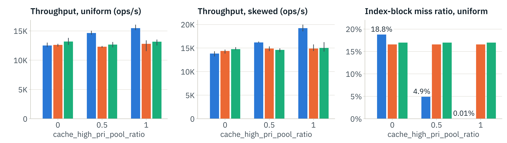
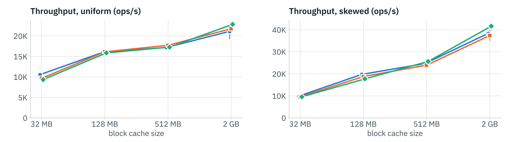
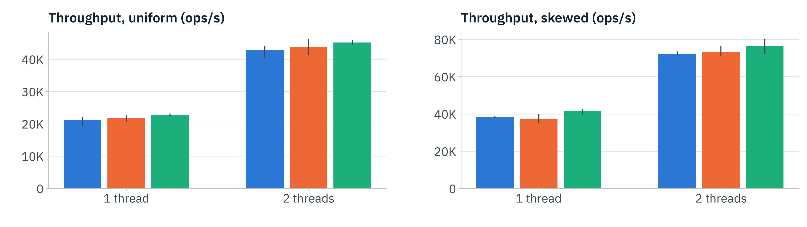
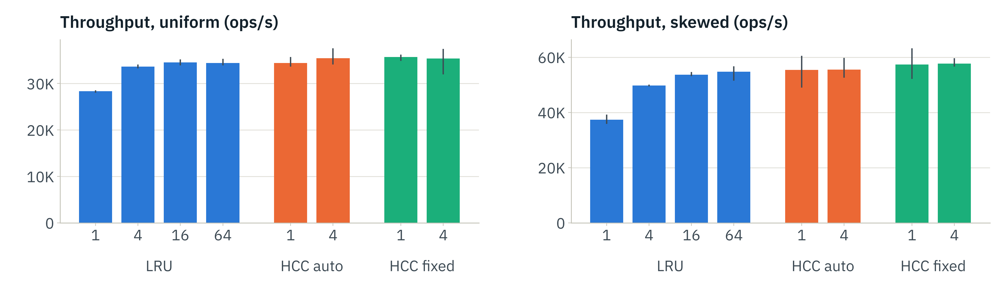
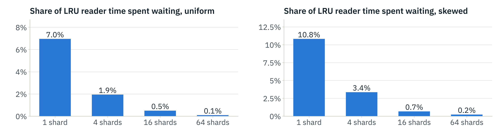
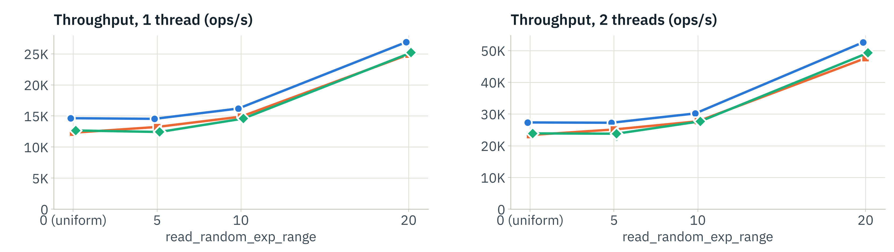

# HyperClockCache vs LRUCache in RocksDB

**CS 434/634, Fall 2026 · Project P1 · Mustafa Berkay Akbiyik**

A performance comparison of RocksDB's two block caches, **LRUCache** and
**HyperClockCache** (auto and fixed variants), run with `db_bench` from RocksDB
**v11.8.1** and configured exactly as in the instructor's setup document. This
repository holds the code that builds the database and runs every experiment,
and all raw logs and processed results of the first full run (246
measurements on a 2-core cloud VM).

## Start here

| If you want to… | Open |
|---|---|
| Read the results, with numbers | [`docs/RESULTS.md`](docs/RESULTS.md) |
| See how each line of the setup document is implemented | [`docs/REQUIREMENTS_TRACE.md`](docs/REQUIREMENTS_TRACE.md) |
| See one table per experiment | [`results/tables/`](results/tables) |
| See the figures | [`results/figures/`](results/figures) (and [`results/figures/slides/`](results/figures/slides) for the slide versions) |
| Use the numbers yourself | [`results/csv/summary.csv`](results/csv/summary.csv) (one row per configuration) and [`results/csv/runs.csv`](results/csv/runs.csv) (one row per repetition) |
| Inspect a single run | unzip [`results/raw.zip`](results/raw.zip), then open `raw/<config>/rep<k>/` (see [Output](#output) for the naming) |
| Rerun everything | [How to reproduce](#how-to-reproduce) |

To keep the repository small, the raw logs are zipped: `results/raw.zip` (main
run, 246 measurements), `results/calibration.zip`, `results_lockstat/raw.zip`
and `results_smoke/raw.zip`. Unzip each one in its own folder to get the
folder layout described below.

## Key findings so far (2 vCPUs, 1–2 threads)

1. **When index and filter blocks barely fit in the cache, LRUCache wins.** At
   64 MB, HyperClockCache is 6–16 % slower than LRUCache (pool ratio 0.5).
   LRU's high-priority pool keeps most of the 34.8 MiB of index and filter
   blocks cached. HyperClockCache has no pools and only starts these blocks
   with a higher CLOCK count (3 instead of 2), so it misses more of them, and
   every miss is an extra 4 KB disk read (E0, E4).
2. **When they fit easily (128 MB and up), there is no clear winner.** The gaps
   stay within about ±10 %, mostly within run-to-run noise (E1, E2).
3. **HyperClockCache lookups take no lock.** With one shard, LRUCache already
   loses 18 % (uniform keys) to 32 % (skewed keys) at 2 threads, and its reader
   threads spend 7–11 % of their time waiting for the shard mutex.
   HyperClockCache with 1 or 4 shards matches LRU with 64 shards (E3). With
   LRU's default 64 shards and only 2 threads there is no contention to see, so
   a many-core machine is the next step.

### At a glance

Blue = LRUCache, orange = HyperClockCache (auto), green = HyperClockCache
(fixed). Each value is the mean of 3 runs; whiskers show min–max.
"Skewed" = `read_random_exp_range=10`.

**E0** · 64 MB cache, 1 thread: LRU's priority pool keeps index and filter
blocks cached; the ratio does nothing for HyperClockCache.


**E1** · cache size, 1 thread: LRU leads only while index + filter do not fit.


**E2** · thread scaling, 2 GB cache: all three caches scale from 1 to 2 threads.


**E3** · shards, 1 GB cache, 2 threads: one LRU shard loses 18–32 %;
HyperClockCache loses nothing.


**E3, lock wait** · share of LRU reader-thread time spent waiting for a shard
mutex (HyperClockCache: 0 %, its lookups take no mutex).


**E4** · skew, 64 MB cache: LRU leads at every skew level.


## Experiments and where their results are

| | Configuration (setup document) | Table | Figure |
|---|---|---|---|
| E0 | 64 MB, `cache_high_pri_pool_ratio` 0 / 0.5 / 1, 1 thread | [E0_ratio.md](results/tables/E0_ratio.md) | [E0_ratio.png](results/figures/E0_ratio.png) |
| E1 | 32 MB, 128 MB, 512 MB, 2 GB; 1 thread; uniform and skewed | [E1_cache_size.md](results/tables/E1_cache_size.md) | [E1_cache_size.png](results/figures/E1_cache_size.png) |
| E2 | 2 GB; 1, 2, … up to #cores threads | [E2_threads.md](results/tables/E2_threads.md) | [E2_threads.png](results/figures/E2_threads.png) |
| E3 | 1 GB; LRU 1/4/16/64 shards vs HCC 1/4 shards; max threads | [E3_shards.md](results/tables/E3_shards.md), [lock_wait.md](results/tables/lock_wait.md) | [E3_shards.png](results/figures/E3_shards.png) |
| E4 | 64 MB; `read_random_exp_range` 0/5/10/20; 1 and max threads | [E4_skew.md](results/tables/E4_skew.md) | [E4_skew.png](results/figures/E4_skew.png) |

E0 is the setup document's 64 MB block that varies the pool ratio. All
experiments together: 82 configurations × 3 repetitions = 246 measurements,
summarized in [`results/tables/summary.md`](results/tables/summary.md).

Metrics, as the setup document asks: throughput (ops/s); read latency p50, p99,
p99.9; block-cache miss ratio split into data, index and filter blocks. The
lecture also asks for CPU cost and lock wait time: the tables report CPU time
per lookup, and [`results/tables/lock_wait.md`](results/tables/lock_wait.md)
reports LRU's mutex wait time.

## Repository map

```
config/
  common.sh              every db_bench flag from the setup document, paths, cache settings
  plan.sh                the configurations of E0–E4
scripts/
  00_env_info.sh         record CPU, RAM, disk, kernel             -> results/env.txt
  01_build_rocksdb.sh    clone RocksDB v11.8.1, release build of db_bench, build tools/lockstat
  02_load_db.sh          load 10M keys, verify, back up the DB     -> data/db_backup, results/load/
  03_smoke_test.sh       one-minute check of the whole pipeline    -> results_smoke/
  04_calibrate_reads.sh  choose the number of lookups per point    -> results/reads.tsv, results/calibration/
  05_run_experiments.sh  run E0–E4, 3 repetitions, resumable       -> results/raw/
  run_one.sh             one measurement: restore, W run, restore, WM run
  verify_db.sh           checks on the loaded database
  package.sh             pack the results into an archive
analysis/
  parse_runs.py          raw logs -> results/csv/runs.csv, summary.csv (does the WM − W subtraction)
  check_results.py       sanity checks on every run                -> results/csv/checks.txt
  plot_results.py        figures and Markdown tables               -> results/figures/, results/tables/
  slide_charts.py        the charts used in the midway slides      -> results/figures/slides/
  summarize.py, choose_reads.py, verify_db.py, rusage_run.py       helpers
tools/lockstat/          LD_PRELOAD library that times contended pthread mutex waits (lockstat.c)
docs/
  RESULTS.md             results of the first full run, with explanations
  REQUIREMENTS_TRACE.md  setup document line by line -> flag, script, check
results/                 main run (246 measurements)
  env.txt, build_info.txt, build.log   machine, RocksDB commit, compiler flags
  load/                  load log, OPTIONS, RocksDB LOG, sst_dump properties, db_summary.json
  calibration.zip        the short runs that chose the lookups per point
  raw.zip                raw/<config>/rep<k>/: db_bench output and everything needed to repeat the run
  csv/                   runs.csv, summary.csv, checks.txt
  tables/                one Markdown table per experiment, lock_wait.md, summary.md
  figures/               one figure per experiment (PNG and PDF), slides/
results_lockstat/        separate lock-wait pass (36 runs, LRU mutex waits); raw logs in raw.zip
results_smoke/           output of the smoke test; raw logs in raw.zip
```

## How one measurement works

Implemented in [`scripts/run_one.sh`](scripts/run_one.sh); the numbers are
extracted by [`analysis/parse_runs.py`](analysis/parse_runs.py).

1. Restore the database from the backup, so every run starts from the
   identical LSM tree.
2. **W run**: `--benchmarks=readrandom,stats`, the warm-up alone.
3. Restore again.
4. **WM run**: `--benchmarks=readrandom,stats,readrandom,stats`, the same
   warm-up followed by the measured phase.

Throughput and the latency percentiles come from the second `readrandom` of the
WM run. The statistics tickers (`rocksdb.block.cache.{data,index,filter}.{hit,miss}`)
are cumulative for the whole process, are printed only when db_bench exits, and
are not cleared by `resetstats`, so the measured phase's tickers are **WM − W**.
With `seed=42` both warm-ups look up exactly the same keys. All 246 runs pass
the checks in [`results/csv/checks.txt`](results/csv/checks.txt): lookups =
threads × reads, the cache type, size and shard count that RocksDB actually
applied (from its LOG), direct reads on, 1-thread repetitions agreeing to within
0.035 % of the accesses, and a multi-thread subtraction error of at most 0.21 %.

The number of lookups per thread (`--reads`) is chosen per point by
[`scripts/04_calibrate_reads.sh`](scripts/04_calibrate_reads.sh) so that the
warm-up fills the cache and every phase lasts at least 10 s. All cache types at a
point use the same value, so they look up the same keys.

## Deviations from the setup document, and decisions

Measured differently from what the document expects:

* **Index size.** The index is 22.7 MiB, not about 60 MB (RocksDB 11.8.1
  shortens index keys). Index + filter = 34.8 MiB, so the document's conclusion
  still holds: no fit at 32 MB, a fit at 128 MB.
* **E2 is not fully cached.** 2 GB holds only about 40 % of the 4.8 GiB of data
  blocks, so with uniform keys 60 % of data-block lookups still miss.
* **Up to #cores.** The VM has 2 cores, so E2 and E3 stop at 2 threads so far.
* **CPU cycles.** The VM exposes no hardware performance counters, so CPU cost
  is reported as CPU time per lookup.

Decisions where the document is silent:

* "Skewed" = `read_random_exp_range=10`, the middle of the document's list.
* Outside E3, each cache uses its own default number of shards, always set
  explicitly with `cache_numshardbits` (LRU: 64; HCC: one per 32 MB).
* `--reads` per point by calibration (see above).
* Warm-up counts come from a separate warm-up-only run (W).
* The load runs `flush` before `waitforcompaction`, because with the WAL off
  the last memtable would otherwise be flushed only when the DB closes.

## How to reproduce

### What you need

* Linux, with the data directory on **ext4 or xfs** (direct I/O)
* about **12 GB free** for the data (DB ~5.2 GB plus one backup copy) and
  ~3 GB for the RocksDB build
* RAM: 2 GB block cache plus a few hundred MB (an 8 GB machine is enough)
* `g++` (C++20), `make`, `git`, `libgflags-dev`, the compression headers
  (`libsnappy-dev liblz4-dev libzstd-dev zlib1g-dev libbz2-dev`; the runs use no
  compression, but RocksDB 11.8.1 does not compile in release mode without
  Snappy), `rsync`, `python3` with `pandas` and `matplotlib`
* For E2 and E3, as many CPU cores as possible (threads never exceed the cores)

Ubuntu/Debian:

```bash
sudo apt-get install build-essential git libgflags-dev libsnappy-dev liblz4-dev \
     libzstd-dev zlib1g-dev libbz2-dev rsync python3-pandas python3-matplotlib
```

### Steps

```bash
./scripts/00_env_info.sh              # record CPU, RAM, disk, kernel   -> results/env.txt
./scripts/01_build_rocksdb.sh         # RocksDB v11.8.1 release build   -> rocksdb/db_bench
./scripts/02_load_db.sh               # 10M keys, verify, back up       -> data/db_backup
./scripts/03_smoke_test.sh            # one-minute pipeline check       -> results_smoke/
./scripts/04_calibrate_reads.sh       # lookups per thread per point    -> results/reads.tsv
./scripts/05_run_experiments.sh --dry-run    # list every configuration
./scripts/05_run_experiments.sh              # E0..E4, 3 repetitions each (resumable)
python3 analysis/parse_runs.py               # -> results/csv/runs.csv, summary.csv
python3 analysis/check_results.py            # sanity checks -> results/csv/checks.txt
python3 analysis/plot_results.py             # -> results/figures, results/tables
```

Optional lock-wait pass, after the main runs:
`LOCKSTAT=1 RESULTS=$PWD/results_lockstat READS_FILE=$PWD/results/reads.tsv REPS=1 ./scripts/05_run_experiments.sh E2 E3 E4`,
then `python3 analysis/parse_runs.py results_lockstat`.

* Put the data on another disk with `DATA_ROOT=/path ./scripts/...` (use the
  same value for every step).
* Run a subset with `./scripts/05_run_experiments.sh E1 E4`.
* The experiment script skips finished repetitions, so it can be stopped
  (Ctrl-C, `touch results/STOP`, or `STOP_AFTER_MIN=120`) and started again.
* On a new machine, rerun steps 00–04: the calibration is machine-specific.

### Output

After unzipping `results/raw.zip` inside `results/`, every run has its own folder:

```
results/raw/<config>/rep<k>/
  w.log, wm.log          db_bench output of the W and WM runs (*.log.err: its stderr)
  *.cmd                  the exact db_bench command
  *.OPTIONS              the full RocksDB options file
  *.LOG.gz               RocksDB's own LOG
  *.rusage.json          CPU time of the process
  meta.json              configuration and timing
```

`<config>` = `<cache_type>__c<MB>M__s<shard bits>__r<pool ratio>__t<threads>__x<read_random_exp_range>__n<reads per thread>`.
For example, `lru_cache__c64M__s6__r0.5__t1__x0__n…` is LRUCache, 64 MB,
2⁶ = 64 shards, pool ratio 0.5, 1 thread, uniform keys.

## Not included

* **The database** (about 5 GB, plus a 5 GB backup): rebuilt by
  `scripts/02_load_db.sh`.
* **RocksDB itself**: `scripts/01_build_rocksdb.sh` clones v11.8.1 (commit
  `abeebd9630f11bd08c28b7bd43c7bdfc62050654`) and builds `db_bench`; the exact
  compiler flags are in [`results/build_info.txt`](results/build_info.txt).
